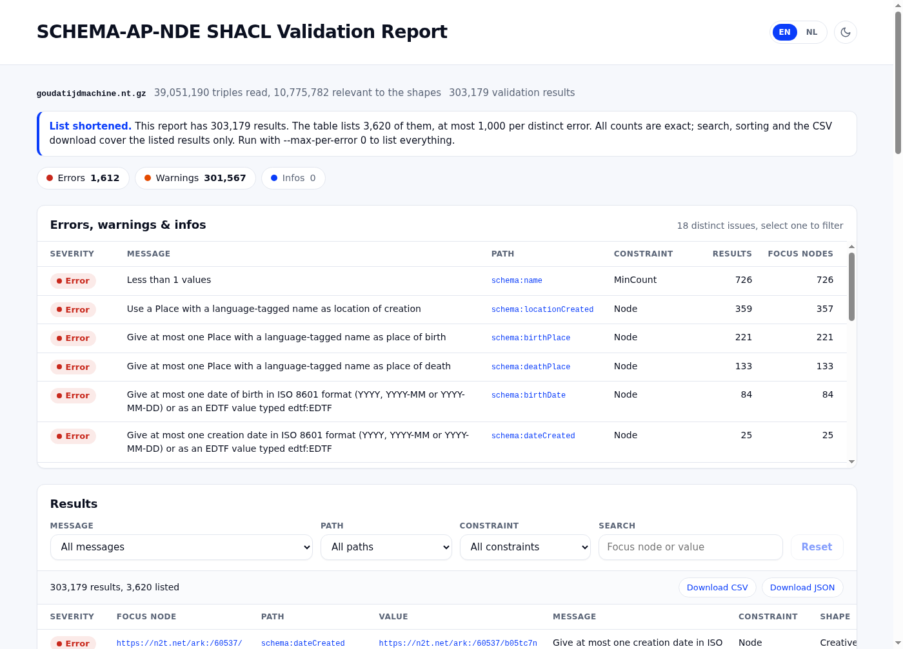

# SCHEMA-AP-NDE-SHACL-HTML-CLI

Valideert linked data tegen het [SCHEMA-AP-NDE](https://docs.nde.nl/schema-profile/)-profiel van het Netwerk Digitaal Erfgoed en schrijft de uitkomst weg als **één HTML-bestand** dat je kunt openen, mailen of archiveren: een overzicht per fout, met daaronder een doorzoekbare en filterbare lijst van alle meldingen.

```sh
node cli.js mijn-collectie.nt
# -> mijn-collectie.shacl.20261110-154429.html
```



De SHACL-shapes worden bij elke run vers opgehaald uit de [schema-profile-repository](https://github.com/netwerk-digitaal-erfgoed/schema-profile/blob/main/shacl.ttl)
van NDE. Je valideert dus altijd tegen de actuele versie van het profiel, en het rapport vermeldt welke versie dat was.

## Afhankelijkheden

| Nodig | Versie | Waarvoor |
|---|---|---|
| [Node.js](https://nodejs.org/) | 20 of hoger (getest met 24.18) | de tool zelf |
| npm | komt mee met Node.js | installeren van de bibliotheken |
| internetverbinding | | ophalen van de shapes bij elke run, en van online invoer |

Java, Apache Jena of Python zijn **niet** nodig. De bibliotheken die `npm install`
binnenhaalt:

| Pakket | Versie | Rol |
|---|---|---|
| [shacl-engine](https://github.com/rdf-ext/shacl-engine) | 1.1.3 (vastgezet) | de SHACL-validatie |
| [n3](https://github.com/rdfjs/N3.js) | 2.x | lezen van Turtle, N-Triples, N-Quads en TriG |
| [rdf-dereference](https://github.com/rubensworks/rdf-dereference.js) | 5.x | ophalen van URL's, met content negotiation |
| [rdf-parse](https://github.com/rubensworks/rdf-parse.js) | 5.x | lezen van JSON-LD, RDF/XML en RDFa |
| [rdf-ext](https://github.com/rdf-ext/rdf-ext) en [grapoi](https://github.com/rdf-ext/grapoi) | 2.x en 1.x | RDF-bouwstenen die de engine verwacht |

De versie van `shacl-engine` staat bewust vast: zie
[Bekende eigenaardigheden](#bekende-eigenaardigheden).

## Installatie

```sh
git clone https://github.com/coret/SCHEMA-AP-NDE-SHACL-HTML-CLI.git
cd SCHEMA-AP-NDE-SHACL-HTML-CLI
npm install
```

Controleer of het werkt:

```sh
npm test            # 16 tests, zonder internet
node cli.js --help
```

Wil je de opdracht overal kunnen aanroepen, dan maakt `npm link` hem beschikbaar als
`schema-ap-nde-shacl-html-cli`. In de voorbeelden hieronder staat steeds `node cli.js`.

## Gebruik

```
node cli.js <bestand-of-url> [opties]
```

De invoer is een RDF-bestand in Turtle, N-Triples, N-Quads, TriG, JSON-LD, RDF/XML of
RDFa. Dat mag een lokaal bestand zijn of een `http(s)`-URL, en het mag met gzip zijn
ingepakt (`.gz`).

| Optie | Betekenis |
|---|---|
| `-o`, `--output <bestand>` | Naam van het rapport. Zonder deze optie: de naam van de invoer, met de extensie vervangen door `.shacl.<JJJJMMDD-UUMMSS>.html` |
| `--shapes <bestand-of-url>` | Andere shapes gebruiken dan die van SCHEMA-AP-NDE (Turtle) |
| `--schema-https` | `http://schema.org/` in de data vóór het valideren herschrijven naar `https://schema.org/` |
| `--max-per-error <n>` | Bij meer dan 50.000 meldingen: toon hooguit *n* meldingen per unieke fout (standaard 1000, `0` = alles tonen) |
| `--all-triples` | Alle triples in het geheugen houden in plaats van alleen de relevante (zelfde uitkomst, veel meer geheugen) |
| `-t`, `--title <tekst>` | Titel van de pagina |
| `-l`, `--lang <taal>` | Voorkeurstaal van de foutmeldingen, bijvoorbeeld `nl` |
| `-h`, `--help` | Uitleg tonen |

Voortgang en een samenvatting verschijnen op stderr; naar stdout gaat niets. De
afsluitcode is `0` zodra het rapport geschreven is, ook als de data fouten bevat, en `1`
als er iets misging (invoer niet te lezen, shapes niet op te halen, enzovoort).

### Voorbeeld 1: een lokaal bestand

```sh
node cli.js ../mh.nt
```

```
Fetching shapes https://raw.githubusercontent.com/netwerk-digitaal-erfgoed/schema-profile/refs/heads/main/shacl.ttl ...
Loading ../mh.nt ...
Validating 64,545 of 92,233 statements (the rest cannot affect these shapes) ...
  1,351 results (2.0s)
../../mh.shacl.20261110-155205.html: 1,351 results (1,351 Warning), conforms: false (2.1s)
```

Het rapport komt naast het invoerbestand te staan. Elke run krijgt een eigen tijdstempel
in de naam, zodat een eerder rapport niet wordt overschreven en je de uitkomst van vóór
en na een verbetering naast elkaar kunt leggen.

### Voorbeeld 2: een online bestand

De volledige dump van de Gouda Tijdmachine: 388 MB gzip, 39 miljoen triples.

```sh
NODE_OPTIONS=--max-old-space-size=24000 \
  node cli.js https://www.goudatijdmachine.nl/omeka/files/goudatijdmachine.nt.gz
```

```
Fetching shapes https://raw.githubusercontent.com/netwerk-digitaal-erfgoed/schema-profile/refs/heads/main/shacl.ttl ...
Loading https://www.goudatijdmachine.nl/omeka/files/goudatijdmachine.nt.gz ...
  5,000,000 statements read (17.9s)
  ...
  35,000,000 statements read (131.5s)
Validating 10,775,782 of 39,051,190 statements (the rest cannot affect these shapes) ...
  303,179 results (451.2s)
The report lists 3,620 of 303,179 results (at most 1,000 per distinct error); all counts are exact.
goudatijdmachine.shacl.20261110-155100.html: 303,179 results (1,612 Error, 301,567 Warning), conforms: false (452.1s)
```

Dat duurde hier ruim zeven minuten en vroeg ongeveer 15 GB geheugen. Het rapport zelf is
maar 488 KB: het bevat alle tellingen (18 unieke fouten, 1.612 fouten en 301.567
waarschuwingen) en van elke fout hooguit duizend voorbeelden. De tijden hierboven zijn
gemeten met een lokale kopie van het bestand; via de URL komt daar de downloadtijd bij.

Bij een URL komt het rapport in de map waar je de opdracht uitvoert. `NODE_OPTIONS` is
hier nodig omdat Node standaard niet meer dan ongeveer 4 GB geheugen gebruikt; voor
kleine bestanden kun je het weglaten.

## Wat het doet

1. **Shapes ophalen.** De actuele `shacl.ttl` van SCHEMA-AP-NDE, zonder cache. Lukt dat
   niet, dan stopt de run: valideren tegen een oude kopie zou een rapport opleveren
   waarvan je niet weet wat het waard is.
2. **Data inlezen, als stroom.** Het bestand wordt niet eerst in zijn geheel geladen.
   Alleen triples die de shapes kunnen raken blijven in het geheugen: de predicaten uit
   de `sh:path`'s, plus `rdf:type`. Bij de Gouda Tijdmachine is dat 10,8 van de 39
   miljoen triples. De uitkomst verandert daar niet door.
3. **Valideren** met `shacl-engine`, volledig in JavaScript.
4. **Rapport schrijven.** Eén HTML-bestand met alles erin: opmaak, script en de
   meldingen zelf. Er wordt niets van internet geladen als je het opent.

## Het rapport

- **Chips per ernst**: Errors, Warnings en Infos, altijd alle drie, ook als de teller op 0
  staat. De chips tonen altijd het totaal van het hele rapport en tellen dus op tot de
  kolom Results in de tabel eronder. Klik om te filteren.
- **Errors, warnings & infos**: één regel per unieke fout (ernst, melding, pad, soort controle), met het
  aantal meldingen en het aantal objecten waar het om gaat. Klik op een regel om de
  lijst eronder tot die fout te beperken.
- **Filters** op melding, pad en soort controle, en een zoekveld op de URI van het
  object of de waarde. De tellers in elk filter houden rekening met de andere filters.
- **Lijst van meldingen**: sorteerbaar, 50, 100 of 500 per pagina, met een link naar
  elk object.
- **Nederlands of Engels**: de shapes van NDE bevatten de meldingen in beide talen.
- **Licht of donker**, met een schakelaar rechtsboven.
- **Deelbaar**: de gekozen filters staan in de URL, en de gefilterde lijst is als CSV te
  downloaden.
- **Herleidbaar**: onderaan staat wanneer de shapes zijn opgehaald, met een
  controlegetal van het bestand, en welke versie van de engine is gebruikt.

## Goed om te weten

**`http://schema.org/` of `https://schema.org/`.** De shapes kijken alleen naar
`https://schema.org/`. Data die nog `http://schema.org/` gebruikt wordt daardoor in het
geheel niet gecontroleerd, en zou zonder waarschuwing een leeg en dus schijnbaar
foutloos rapport geven. De tool telt die triples en zet een duidelijke melding bovenaan
het rapport. Met `--schema-https` wordt de naamruimte eerst herschreven. Let op bij
JSON-LD: `"@context": "https://schema.org"` levert, als de context echt bij schema.org
wordt opgehaald, toch `http://schema.org/` op.

**Een leeg rapport is geen goedkeuring.** Bevat de data geen enkel object waar de shapes
iets over zeggen (geen `schema:CreativeWork`, `schema:Person` en dergelijke), dan staat
er "Nothing was validated" in plaats van "Conforms".

**Grote bestanden.** Het filter bij het inlezen maakt dumps van tientallen miljoenen
triples haalbaar, maar wat overblijft moet nog steeds in het geheugen passen.

**Heel veel meldingen.** Boven de 50.000 meldingen toont de lijst hooguit 1000
voorbeelden per unieke fout. Alle tellingen blijven exact; de pagina vermeldt dat de
lijst is ingekort. Zoeken, sorteren en de CSV-download gaan dan over de getoonde
meldingen.

## Getoetst tegen Apache Jena

De uitkomst is vergeleken met Apache Jena 5.6.0 (`shacl validate`), met dezelfde shapes
en per melding het object, het pad, de ernst en de soort controle.

| Data | Triples | Meldingen volgens Jena | Deze tool |
|---|---|---|---|
| `mh.nt` (middeleeuwse handschriften, KB) | 92.233 | 1.351 waarschuwingen | identiek |
| `mh.nt` met opzettelijk kapotgemaakte waarden | 85.514 | 6.585 fouten, 3.125 waarschuwingen | identiek |
| 64 voorbeeldbestanden uit de schema-profile-repository | 8 tot enkele honderden | 188, in 57 bestanden | identiek |

De dump van de Gouda Tijdmachine (39 miljoen triples, 303.179 meldingen) is alleen met
deze tool gedraaid en niet met Jena vergeleken.

## Bekende eigenaardigheden

- **`shacl-engine` 1.1.3 laat meldingen vallen.** De engine onthoudt welke combinaties
  van shape en object al zijn gecontroleerd, maar zoekt de onthouden meldingen terug
  onder een andere sleutel dan waaronder ze zijn opgeslagen. Wordt een shape eerst
  genest geëvalueerd (via `sh:or`, `sh:node` of `sh:qualifiedValueShape`) en daarna
  rechtstreeks, dan verdwijnen meldingen. De shapes van NDE hebben precies die opbouw
  rond `associatedMedia`: in 7 van de 64 voorbeeldbestanden ontbraken daardoor fouten
  die Jena wel gaf, zoals een `contentUrl` die geen URI is. `lib/validate.js` herstelt
  dat, en `test/fixtures/shapes.ttl` bewaakt het met een test. Omdat de reparatie
  ingrijpt in de binnenkant van de bibliotheek, staat de versie vast. Nog niet gemeld
  bij de makers.
- **Dezelfde engine liep vast op grote dumps.** De boekhouding van de engine groeit met
  elk gecontroleerd object en stuitte bij ruim een miljoen personen op de grens van een
  JavaScript-`Map` (16,7 miljoen items). Ook dat is in `lib/validate.js` begrensd.
- **`rdf-validate-shacl` als alternatief viel af.** Die bibliotheek miste op de
  kapotgemaakte testset 1.693 van de 9.710 meldingen en was ongeveer drie keer trager.
- **`sh:conforms` is `false` bij elke melding**, ook als het alleen waarschuwingen zijn.
  Het rapport toont daarom geen "voldoet niet", maar laat de tellers per ernst spreken.

## Testen

```sh
npm test
```

Zestien tests, zonder internet: het inlezen van Turtle, JSON-LD, RDF/XML en gzip, het
filter, de reparatie van de engine, de `http://schema.org/`-afhandeling, het inkorten
van lange lijsten, de naamgeving van het rapport en de opdrachtregel zelf. De verwachte
uitkomst in `test/validate.test.js` is die van Jena.

## Mappen

```
cli.js              de opdrachtregel
lib/
  load.js           inlezen van data (stroom, filter, gzip) en shapes
  validate.js       de validatie, met de reparaties van shacl-engine
  parse.js          van meldingen naar het compacte model voor de pagina
  render.js         model + sjabloon -> HTML
  template.html     de pagina: opmaak en script
test/               tests en voorbeelddata
docs/DESIGN.md      ontwerpkeuzes, het JSON-model en de toetsing in detail (Engels)
```

## Nog niet

- [ ] De fout in `shacl-engine` melden bij de makers
- [ ] Dumps die ook na het filteren niet in het geheugen passen
- [ ] Zoeken in de tekst van de meldingen, en zoeken voorbij de getoonde meldingen in
      een ingekort rapport
- [ ] Andere compressie dan gzip (`.bz2`, `.zip`)
- [ ] Het SHACL-rapport ook als Turtle wegschrijven
- [ ] Uitleg bij een mislukte `sh:or` of `sh:node` (`sh:detail`)
- [ ] De vergelijking met Jena en een browsertest opnemen in `npm test`
- [ ] Een Nederlandstalige interface (de meldingen zijn al tweetalig, de knoppen niet)

## Licentie

[MIT](LICENSE). Het uiterlijk van het rapport volgt de
[ErfgoedKijker](https://erfgoedkijker.coret.org/).
